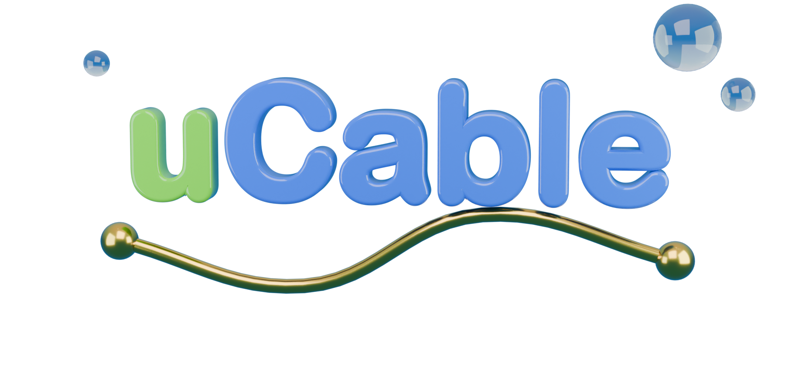

<p align="center">
  
</p>

<p align="center">
  <b>Your YouTube subscriptions, as a 2000s satellite TV.</b>
</p>

<p align="center">
  
  = 22.18">
  
</p>

---

uCable takes the videos of the last 14 days from your subscriptions and puts them on a schedule. Each channel is a topic. A model (Jev) tags each video. The scheduler, plain code, decides the order and remembers what you already watched.

## How it works

```
Google login → videos of the last 14 days → Jev tags each video → scheduler → TV guide
```

- **Numbered channels**, like a decoder: type `1` `0` `5` to change channel.
- **TV guide** with two screens: group menu (1-9, 0) and timeline grid.
- **Memory**: resume where you left off. Finished videos go to the bottom, but stay in the guide.
- **No infinite feed**: the schedule changes with the time of day and with what you watch.

## Quick start

Requirements: Node 22.18 or later, a Google Cloud project with YouTube Data API v3, a TypeSafe key.

```bash
git clone https://github.com/hiitsmax/ucable.git
cd ucable
npm install
cp .env.example .env.local
cp profile.example.json profile.json
npm start
```

Then open http://localhost:3001 and log in.

### Google and TypeSafe setup

1. **Google Cloud Console**: create a project and enable **YouTube Data API v3**.
2. **OAuth consent screen**: type *External*, status *Testing*. Add your account as a test user. In Testing mode the login accepts 100 users at most.
3. **Credentials** → OAuth client ID → *Web app* → redirect URI `http://localhost:3001/api/auth/callback/google`.
4. **TypeSafe**: create a key at https://typesafe.ai. Jev is their model. The endpoint is `api.typesafe.ai`.
5. Fill in `.env.local`: `GOOGLE_CLIENT_ID`, `GOOGLE_CLIENT_SECRET`, `TYPESAFE_API_KEY`.
6. Describe yourself in `profile.json` (field `about`).

The first load tags the full window: about one Jev call per video, four at a time. Slow once, fast after.

## Controls

| Key | Action |
|---|---|
| `0`–`9` | Type the channel number (3 digits, or 1–2 digits = 100+n) |
| `↑` / `↓` | Channel up / down |
| `Space` | Pause |
| `←` / `→` | Back / forward 10 seconds |
| `N` | Not interested (gone for good) |
| `L` | Not now (returns after 8 hours) |
| `U` | Undo the last `N` or `L` |
| `P` | Previous video |
| `R` | Restart from the beginning |
| `M` | Mute |
| `I` / `Enter` | Show the banner |
| `G` | Guide (arrows to move, `Enter` to watch, `Esc` to close) |

## Customization

Three files, read again on every request. Edit, reload, and the videos are re-tagged automatically.

- **`channels.json`**: the channel list. The order is the channel number. The last one is the catch-all.
- **`prompts.json`**: the instructions of the Jev questions.
- **`profile.json`**: who watches (`about`), favourite creators (`creators`), scheduler weights (`weights`).

You can also edit them in `/lab` (http://localhost:3001/lab).

## Structure

| Path | Contents |
|---|---|
| `app/page.tsx` | TV interface: boot, player, keyboard, banner, guide |
| `app/api/videos/route.ts` | Backend: YouTube → Jev → channels |
| `lib/schedule.ts` | Scheduling algorithm. Pure, no model |
| `lib/jev.ts` | Jev client and questions |
| `lib/youtube.ts` | YouTube Data API |
| `design/` | Blender scripts for logos and icons |

## Check

```bash
node lib/check.ts
```

Checks the parser and the scheduler.

## Notes

- The Google token lasts one hour. Then log in again.
- The history is stored in the browser (`localStorage`), not in your account.
- Jev reads text only: title, description, tags, category, duration, date, views, channel and your description in `profile.json`.
- The UI is in Italian.

## Author

Made by [hiitsmax](https://github.com/hiitsmax).

## License

[MIT](LICENSE) © 2026 hiitsmax
